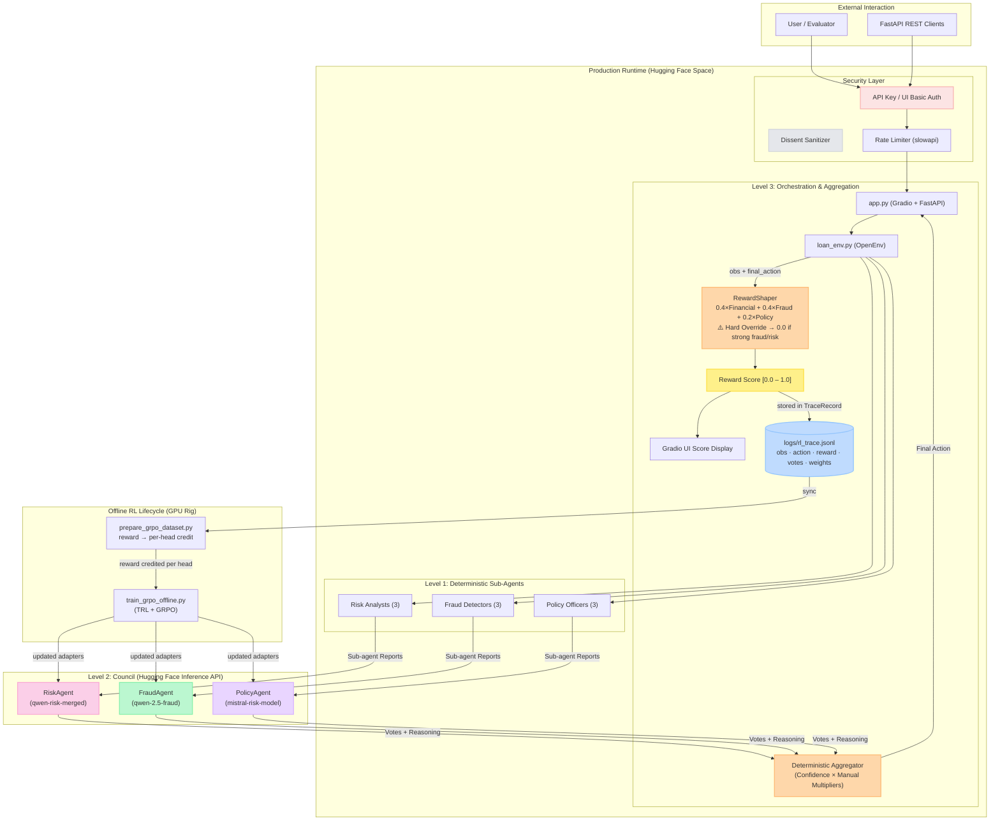

<div align="center">
  
  
  
  
</div>

<br/>

<div align="center">
  <h1>🏦 Sententia (MetaOpenEnv): A Full Credit Committee, Automated</h1>
  <p><em>Production-grade, RL-ready multi-agent underwriting built on Meta's OpenEnv framework.</em></p>
</div>

---

## 💡 The Problem: What Is Wrong with Automated Lending Today

Most production loan systems are single-model pipelines. Input goes in. A score comes out. `APPROVE` or `REJECT` fires. There is no internal deliberation, no domain separation, and no mechanism for the system to say *"I'm not confident — give me more."*

Credit risk is not one problem. It is three distinct problems: **financial capacity, behavioral integrity, and policy compliance**. Collapsing them into a single scoring function dilutes the signal. A fraud pattern gets averaged away by a good credit score; a policy violation is obscured by strong income.

Single-model pipelines don’t just miss edge cases. They have no way to *know* they’re missing them.

## 🚀 The Solution: Sententia

Sententia does not *score* loan applications. It *deliberates* on them across three cascading levels of specialized intelligence, mirroring the structure of a real-world credit committee.



---

## ⚙️ Technical Deep Dive

### 1. Data Ingestion & Pydantic Validation
The environment natively accepts data via CSV/JSON bulk uploads or manual UI entry. Raw data is validated using a Pydantic `LoanObservation` class. The system supports **unlimited input ranges** for financial fields (Loan Term, Monthly Expenses, etc.), allowing for advanced stress-testing beyond traditional banking boundaries.

### 2. Level 1: Specialized Sub-Agents (Rule-Based + LLM Signal)
Nine sub-agents evaluate the application within isolated domains. They use a hybrid of deterministic rules and lightweight LLM signals for fluid policy checks.
*   **Risk Desk:**
    *   `CreditAnalystAgent`: Assesses bureau scores and repayment history.
    *   `IncomeVerifierAgent`: Validates income sufficiency and DTI.
    *   `DebtAnalyzerAgent`: Examines current leverage and total debt limits.
*   **Fraud Desk:**
    *   `PatternCheckerAgent`: Evaluates spending volatility vs. loan size.
    *   `ConsistencyCheckerAgent`: Scans for cross-field contradictions.
    *   `IdentityVerifierAgent`: Evaluates Bank KYC status (VERIFIED/PENDING/FAILED).
*   **Policy Desk:**
    *   `ComplianceOfficerAgent`: Verifies applicant is within the 21–60 age bracket.
    *   `TermValidatorAgent`: Ensures loan terms fit institutional bounds.
    *   `LTVCheckerAgent`: Ensures Loan-to-Value (collateral vs. amount) is mathematically sound.

### 3. Level 2: The Council (Domain-Separated LLM Ensemble)
Three head agents synthesize the 9 sub-reports. Each is powered by a **fine-tuned, domain-specialized LLM** accessed via `huggingface_hub.InferenceClient`.
*   **`RiskAgent` (`Keva1ya/qwen-risk-merged`):** Tabular reasoning over financial capacity.
*   **`FraudAgent` (`Keva1ya/qwen-2.5-fraud`):** Behavioral integrity. Explicitly enforces a hard `REJECT` veto on failed KYC checks.
*   **`PolicyAgent` (`Keva1ya/mistral-risk-model`):** Multi-rule compliance evaluation using Mistral's instruction templates.
*   *Fail-Safe:* If the Hugging Face API is unavailable, agents gracefully default to rule-based fallback logic.

### 4. Level 3: Dynamic Weight Decision Engine & Dissent Logging
The council submits votes (`APPROVE`, `REJECT`, `REQUEST_MORE_INFO`) to the `VotingEngine`.
*   **Dissent Logging:** If the council vote is 2-1, the engine detects dissent, identifies the minority voter, captures their specific two-sentence reasoning, and saves it permanently to `logs/dissent_log.json`.
*   **Tie-Breaking:** The `PolicyAgent` functions as the ultimate tie-breaker for strict regulatory compliance.
*   **Dynamic Multipliers:** Evaluators can manually scale the mathematical weight of Risk, Fraud, or Policy via the UI.

### 5. Structurally Fraud-Proof Reward Shaper
The environment simulates feedback via a robust `RewardShaper`:
```python
Reward = (0.4 * Financial_Score) + (0.4 * Fraud_Score) + (0.2 * Policy_Score)
```
**Hard Overrides:** If the applicant presents severe fraud patterns or a `FAILED` KYC status, the reward is automatically crushed to `0.0`. The RL framework cannot learn to approve fraudulent loans simply because the financial reward is high.

### 6. The Big Brain Server (Offline GRPO RL)
The system is built for **Group Relative Policy Optimization (GRPO)**.
*   **State Trace Buffer:** Every observation, confidence score array, decision, and calculated reward is mathematically compressed into a `float32` state tensor (shape: `28,`) and saved to `logs/rl_trace.jsonl`.
*   **Offline GPU Rig Training:** The `scripts/train_grpo_offline.py` loop reads the trace buffer and utilizes PyTorch and Hugging Face `TRL` (Transformer Reinforcement Learning) to run backpropagation against the `dynamic_weight_net`. 
*   *Purpose:* The RL network does not learn how to underwrite; it learns **how much weight to assign to each Head Agent** based on historical reward trajectories.

### 7. Task Difficulties (Environment Constraints)
*   **`easy`**: Bypasses the LLM council entirely. Evaluates only collateral heuristics (Mortgage Mode Auto-Approval).
*   **`medium`**: Synthesizes a deterministic risk composite score.
*   **`hard`**: The default mode. Triggers the full 3-level pipeline, Hugging Face LLM endpoints, and Dissent Logging.

---

## 💻 Quick Start & Installation

Run the local Risk Desk (Gradio UI + FastAPI backend) to visually process single applicants or batch-process CSV datasets.

### Prerequisites
```bash
git clone https://github.com/keva1ya/Metaopenenv.git
cd Metaopenenv
pip install -r requirements.txt
```

### Configuration
Add your Hugging Face API Token to a `.env` file to enable the Level-2 LLM Head Agents:
```env
HF_TOKEN=hf_your_secure_token_here
```

### Launch
Start the complete Gradio interactive dashboard:
```bash
python3 app.py
```

### Offline Automated Benchmarking
Run the headless offline test benchmark to see the environment interact programmatically:
```bash
python3 scripts/test_offline.py
```

---
*Built for the Meta PyTorch OpenEnv Hackathon × Scaler School of Technology. India's first OpenEnv AI Hackathon.*
